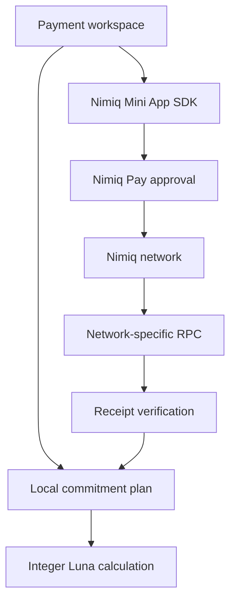
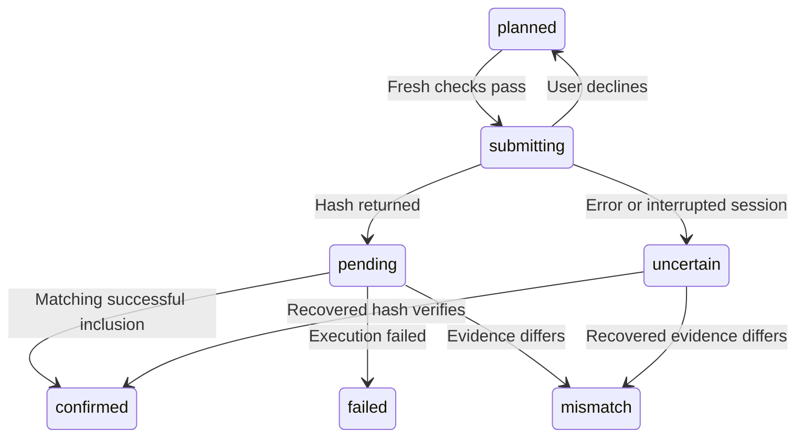

<div align="center">

# QUORAIL

### See what a payment leaves behind.

A Nimiq Pay Mini App for people whose money already has a purpose.

**Plan commitments. Preview the consequences. Approve in your wallet.**

[Getting started](#getting-started) · [How it works](#the-payment-perspective) · [Deployment](docs/DEPLOYMENT.md) · [Verification](docs/TESTING.md) · [Submission](docs/SUBMISSION.md)

Built by **Jayking** · [GitHub @paulos-ui](https://github.com/paulos-ui) · [X @\_\_official\_\_1](https://x.com/__official__1)

</div>

## The problem

A wallet balance does not tell you what you can comfortably pay.

A freelancer may have enough NIM to buy equipment today while that same balance is already needed for rent and a collaborator next week. Wallets make sending straightforward. The missing context is what the payment leaves behind.

Quorail puts recorded commitments beside the balance. Before requesting a payment, it calculates the remaining room after other upcoming payments, explicit fees and the user's reserve target. A user can revise a commitment, defer it beyond the planning window or change their reserve preference before approving a transfer.

The first audience is independent workers and small teams with a single spending account. This is a personal planning tool, not a shared treasury or accounting system.

## The payment perspective

An illustrative plan has:

| Item                         |   NIM |
| ---------------------------- | ----: |
| Account balance              | 1,000 |
| Studio rent                  |   420 |
| Collaborator payment         |   230 |
| Reserve target               |   200 |
| Proposed equipment payment   |   250 |
| Room left after that payment |  -100 |

The wallet can cover the equipment payment. The complete recorded plan cannot. Quorail makes that difference visible before the native wallet approval.

The formula for a selected payment is:

```text
Remaining room = current account balance
               - selected payment and its fee
               - other outstanding commitments within the planning window
               - reserve target
```

The selected payment is excluded from other commitments so it is never counted twice. Overdue commitments remain included. All money arithmetic uses integer Luna, with 100,000 Luna per NIM. No floating-point multiplication is used to parse user-entered amounts.

## What is implemented

| Capability             | Behavior                                                                                                           |
| ---------------------- | ------------------------------------------------------------------------------------------------------------------ |
| Nimiq Pay connection   | SDK initialization, account permission, host-network detection and consensus checks                                |
| Live balance           | Reads the selected planning address through the native `getBalance` method                                         |
| Payment planning       | Create, edit, search and remove unsent commitments with amount, explicit fee, date and priority                    |
| Payment impact         | Computes the balance after the selected transfer, competing obligations, reserve and shortfall                     |
| NIM payment            | Calls `sendBasicTransaction` only after fresh balance, consensus and planning checks                               |
| User control           | Native Nimiq Pay approval is required; the app never holds keys or signs in the background                         |
| Receipt reconciliation | Matches hash, inclusion, sender, recipient, value, network and execution result                                    |
| Recovery               | Persists payment attempts before submission; interrupted attempts become uncertain after reload                    |
| Local workspaces       | Plans separated by address and network in local storage                                                            |
| Backup                 | JSON export; same-account import merges new records and rechecks imported attempts                                 |
| Example workspace      | Clearly labeled illustrative balance; sending and fake receipts are disabled                                       |
| Interface              | Responsive landing page, mobile bottom navigation, desktop sidebar, payment detail dialogs, reduced-motion support |
| Documentation          | In-app field guide, privacy explanation, deployment guide, device test matrix and submission material              |

**Asset scope:** NIM. USDT, staking, on/off-ramp services, recurring automatic payments and custody are not implemented.

## What Nimiq contributes

Nimiq Pay is the actual wallet execution environment. It shares addresses, exposes the host network, reports the account balance and consensus, and presents the approval for each basic NIM transaction. The integration is central to the payment flow.

The app imports `init`, `getHostNetwork` and `NimiqProviderError` from `@nimiq/mini-app-sdk`. Account balance access requires an up-to-date Nimiq Pay host. Unknown host networks are rejected rather than silently assumed to be mainnet.

**Important signer distinction:** `listAccounts()` shares addresses. It does not prove ownership, and selecting an address in Quorail does not choose the native wallet signer. The review asks the user to verify the sending account in Nimiq Pay. Reconciliation checks the actual on-chain sender against the planning account. A mismatch pauses new sends until investigated.

## Architecture



| File                     | Responsibility                                                                        |
| ------------------------ | ------------------------------------------------------------------------------------- |
| `lib/finance.ts`         | Exact amounts, Nimiq checksum validation, commitments, forecast and backup validation |
| `lib/wallet.ts`          | SDK initialization, network checks, wallet error mapping and deep links               |
| `lib/receipt.ts`         | Runtime validation of transaction evidence                                            |
| `lib/rpc.ts`             | Read-only RPC calls with a timeout and network-specific configuration                 |
| `lib/storage.ts`         | Address-scoped and network-scoped persistence and export                              |
| `components/Console.tsx` | Payment state machine and workspace interactions                                      |
| `components/Landing.tsx` | Interactive introduction and scroll-triggered text sections                           |
| `app/docs/page.tsx`      | User guide and privacy information                                                    |
| `tests/finance.test.ts`  | Monetary, planning, recovery and receipt tests                                        |

The application is a static Next.js export. There is no application backend, database password, AI key, relayer, Solidity contract or server-side wallet. This keeps the first version small and deployable, with transparent local-storage tradeoffs.

## Payment states



An ordinary submission error is not treated as proof that nothing was sent. Pending, submitting, uncertain or mismatched records block further sends through this workspace. The user can recover a hash from wallet history and verify it. There is no blind retry or automatic reset of ambiguous attempts.

Browser Web Locks serialize payment requests for the same origin, address and network. A device without Web Locks cannot send through this version. Record writes happen before the native payment request. If storage fails after a hash returns, the UI retains the hash in memory and requests immediate export.

## Design: the payment perspective

The interface uses paper ivory, midnight blue, muted sage and restrained gold. An authored orbital drawing connects commitments to the account balance. The landing interaction previews a payment with real explanatory arithmetic. Motion reveals the story as you scroll, while operational screens remain direct and quick.

Mobile navigation contains Overview, Payments and Activity. The primary action is a payment review, with the before-and-after consequences visible above wallet approval. All motion respects `prefers-reduced-motion`. The project does not use generated raster imagery or a stock dashboard template.

## Getting started

Requirements: Node.js 22 or later and npm.

```bash
npm ci
npm run dev
```

Open `http://localhost:3000` for the introduction. Use `/console/?demo=1` for the example workspace. Native wallet methods require the deployed HTTPS app to run inside Nimiq Pay.

```bash
npm test
npm run typecheck
npm run build
```

`npm run build` produces `out/`, a static website ready for Vercel or another HTTPS static host. Do not use `next start` to serve a static export. Use the development server locally or a static host for `out/`.

### Optional RPC configuration

No environment variables are required for the default public RPC services. To operate a dedicated RPC, copy `.env.example` to `.env.local` and configure the endpoints before building. They are browser-visible public URLs, not secret credentials. Each must match its designated network and allow the app origin through CORS.

The default Nimiq Watch RPC services are listed by the Nimiq Developer Center. They are community infrastructure with no uptime guarantee. A dedicated production endpoint is recommended. If a receipt service is unavailable, the app retains the pending state rather than inventing confirmation.

## Privacy and boundaries

- Plans and labels stay in unencrypted local storage. They are not authenticated private server records.
- Browser profile access can expose local plans. Clearing browser data can lose plans and attempt history.
- Workspaces do not sync between devices. Export before moving devices or changing deployment origins.
- Backup imports are convenience records, not cryptographic payment proofs.
- A reserve target does not lock funds. Quorail cannot prevent payments outside this application.
- Forecasts only cover entered commitments. They do not infer other bills or future income.
- Pending balances may be conservative until receipt verification and balance refresh complete.
- RPC receipt checks expose transaction hashes and the client IP address to the RPC operator.
- Google Fonts requests and ordinary hosting logs may expose client IP addresses to those providers.
- Confirmation reflects successful inclusion reported by the RPC. It is not an independently verified finality proof.
- Basic spendable NIM accounts are the supported path. Contract or staking balances are not treated as available spending accounts.
- No real-user counts, payment volumes, partnerships or competition outcomes are claimed.

## Validation status

The implementation includes automated tests and a production build. See [TESTING.md](docs/TESTING.md) for the exact verified checks and the remaining native-device acceptance tests. Do not describe native wallet payments as tested until the real-device checklist has been completed with genuine transaction evidence.

## From Quorail to Quorail-Nimiq

This is a separate Nimiq adaptation of Jayking's original Quorail project. The consequence-planning concept is retained and rewritten for integer Luna and user-approved wallet payments.

The old chain-specific vault, server signer, owner-only authentication, autonomous AI execution, database setup and bridge tooling are removed from this distribution. They are not hidden behind a new logo. See [MIGRATION.md](docs/MIGRATION.md) for the replacement map.

## Competition entry

Intended category: **Pay**. The central use case is a real NIM payment made with awareness of other commitments. See [SUBMISSION.md](docs/SUBMISSION.md) for the description, demo outline and launch checklist. A submitted entry, recorded demo and real usage must be completed separately.

## Official references

- [Nimiq Mini Apps overview](https://nimiq.dev/mini-apps)
- [Nimiq provider API](https://nimiq.dev/mini-apps/api-reference/nimiq-provider)
- [Nimiq RPC services](https://nimiq.dev/rpc/open-servers)
- [Competition rules](https://miniappscompetition.com/rules)
- [Competition scoring](https://miniappscompetition.com/scoring)

## License

MIT. Original Quorail attribution is preserved in `LICENSE`. Third-party dependencies retain their own licenses. Quorail is an independent application and does not imply Nimiq endorsement.

## Version 2: a clearer next move

The second release adds a cream, ink, yellow and violet visual identity, bolder typography, tactile cards, mobile navigation, scroll reveals and reduced-motion support. The design takes broad inspiration from approachable Nimiq community apps while keeping original Quorail branding and artwork.

### Play room

Visit `/play/` for tic-tac-toe against a minimax bot, local two-player chess, and a payment planning exercise. Chess supports legal destinations, check, checkmate, castling, en passant, promotion choice, repetition draws, move history and undo using chess.js. Games run locally and reset on a page reload. There is no online multiplayer or chess bot.

Games are free practice with no stakes, NIM payouts, redeemable points or reward balances. A funded sponsor campaign, server-authoritative result verification, eligibility rules, abuse controls and an audited payout process are prerequisites for future financial rewards. This release remains a **Pay** submission, with practice as a supporting experience.

### Install on a device

Use **Add to your device** on the home page or Play room. Chromium browsers can expose a native install prompt when eligible. Other browsers show installation instructions. iOS uses Safari's Share menu; desktop Safari uses Add to Dock. Installation requires HTTPS in production. Wallet WebViews may not support installation; open the same URL in a regular browser.

The installed app does not supply a wallet bridge. Actual wallet approvals still require Nimiq Pay. Local storage is specific to the browser or WebView, so use JSON export/import when moving an existing plan between them. The service worker only caches a connection-loss page, never wallet balances, transactions, RPC responses or application code. Quorail requires a connection to reopen and use the app.

### Verification for this release

15 automated tests pass, including all v1 monetary and receipt guards, exhaustive tic-tac-toe human move paths, illegal chess moves, checkmate and repetition history. The production build and TypeScript checks pass. Browser checks cover the new landing page, tic-tac-toe bot response, a legal chess move and the money exercise. Native wallet signing, real-device installation and real NIM transfers still require device acceptance testing after deployment.

Chess rules are provided by chess.js under BSD-2-Clause. See `docs/CHESS-LICENSE.txt`. The Quorail source remains MIT licensed.
